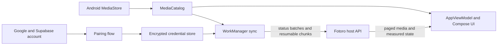

# Fotoro for Android

Fotoro for Android is the phone companion to a media archive on your own Linux host. It shows local and server libraries, transfers original photos and videos in the background, and lets you choose individual documents to offload. The [Fotoro host](https://github.com/Fotoro/Fotoro-Model) owns the catalogue and stored files; the [website](https://github.com/Fotoro/Fotoro-Server) provides account access and device pairing.

## Architecture

`AppViewModel` owns screen state. `data/` contains the MediaStore catalogue, API client, server models and encrypted credential store. `sync/` schedules and performs background work. `ui/` contains onboarding, gallery, viewer, backup and dashboard screens. Compose displays state; uploads stay in WorkManager rather than a screen lifecycle.

## Identity and pairing

The app signs into the same Google and Supabase account as the website. It can use native Google sign-in or a browser handoff. The linked host is discovered from that account; a short-lived pairing invitation exchanges for a revocable device token. The token is stored with Android Keystore-backed encryption and used for device-scoped API requests. Tailscale supplies the route to the host, while the host checks the credential on protected routes.

Native Google sign-in requires an Android OAuth client for package `com.nc.fotoro` with the installed APK's signing certificate SHA-1, in the same Google Cloud project as the website's Web OAuth client. The [v0.1 release](https://github.com/Fotoro/Fotoro-Android/releases/tag/v0.1) lists its certificate fingerprint. Browser sign-in uses the website handoff and does not depend on the Android certificate. The Supabase URL and publishable key are app configuration; a service-role key must never be embedded in the app.

## Backup and browsing

- MediaStore supplies stable media IDs, capture dates and generation counters. The app asks the host about up to 200 items per status batch and hashes only files that need upload. A full reconciliation runs at least daily even when a generation marker has not changed.
- WorkManager schedules periodic checks under battery and network constraints. Automatic backup defaults to unmetered Wi-Fi; Android decides the exact execution time. The foreground app also observes new media. Manual backup and selected-file upload are explicit actions.
- Originals move in 4 MiB chunks. The host records each upload offset and verifies the completed SHA-256 digest. A stopped transfer cancels active and queued work, pauses automatic backup across restarts and resumes from the saved server offset when possible. Progress appears in a foreground notification.
- The app sends capture time with the original. The server catalogue keeps capture time separate from import time. Fotoro never deletes phone media after upload; it reports a primary server copy and a verified second server copy separately.
- The local gallery reads MediaStore. The server gallery pages through `/api/v1/media`, groups by capture month and loads small thumbnails before larger display images. Documents selected through Android's file picker upload in the background; automatic backup covers MediaStore photos and videos only.

## Limits and release notes

Background work needs Android to grant media access, a reachable host and an active Tailscale route. Selected-photo permission limits automatic backup to those selections. The host's second-copy status requires an independently mounted backup disk; one server copy is not two. Full video preview generation and an automated disaster-restore drill remain separate work.

The v0.1 APK is signed for Android 11 and newer. Updates must use the same release signing key. A debug-signed installation cannot be updated in place by the release-signed APK. The public release is a useful test build, but device behavior, network changes and large-library scrolling still need testing on real phones.
